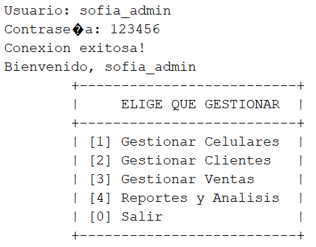
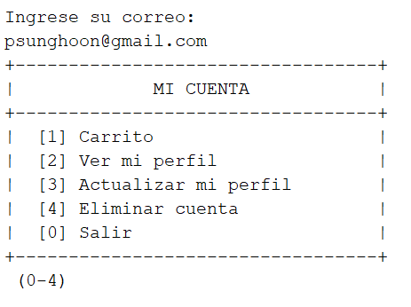

# TecnoStore - Sistema de Gestión de Celulares

Sistema de consola en Java para administrar el catálogo de celulares, los clientes, las ventas y los reportes de una tienda minorista de teléfonos. Reemplaza el control manual en hojas de cálculo por una aplicación con base de datos MySQL.

Aplica Programación Orientada a Objetos, colecciones y Stream API, manejo de excepciones, persistencia con JDBC y tres patrones de diseño: **Singleton**, **Factory** y **Strategy**.


---

## Tabla de contenido

1. [Funcionalidades](#funcionalidades)
2. [Tecnologías](#tecnologías)
3. [Arquitectura del proyecto](#arquitectura-del-proyecto)
4. [Base de datos](#base-de-datos)
5. [Explicación del código](#explicación-del-código)
6. [Patrones de diseño](#patrones-de-diseño)
7. [Reportes y Stream API](#reportes-y-stream-api)
8. [Instalación y ejecución](#instalación-y-ejecución)
9. [Capturas de ejecución](#capturas-de-ejecución)
10. [Autores](#autores)

---

## Funcionalidades

El sistema tiene dos roles, cada uno con su propio menú:

**Administrador**
- Gestionar celulares: registrar, actualizar, eliminar y listar.
- Gestionar clientes.
- Gestionar ventas: listar, ver el detalle, actualizar el estado y eliminar.
- Reportes: stock bajo, top 3 de más vendidos, ventas totales y exportación a `reporte_ventas.txt`.

**Cliente**
- Crear pedidos seleccionando uno o varios celulares.
- Ver sus pedidos.




---

## Tecnologías

| Tecnología | Uso |
|---|---|
| Java (JDK 17 o superior, por el uso de *text blocks* y `Stream.toList()`) | Lógica de negocio y aplicación de consola |
| MySQL | Almacenamiento persistente |
| JDBC | Conexión e interacción con la base de datos |
| Stream API | Procesamiento y análisis de colecciones |
| NetBeans | Entorno de desarrollo |
| Git y GitHub | Control de versiones |

---

## Arquitectura del proyecto

El proyecto está organizado en capas, cada una con una responsabilidad única:

```text
TecnoStoreD/
├── src/
│   ├── com.proyecto.tecnostored/
│   │   └── TecnoStoreD.java          # Punto de entrada
│   ├── controller/
│   │   └── GestionarFlujo.java       # Controla la navegación general
│   ├── controller.Admin/             # Lógica de las opciones del administrador
│   │   ├── GestionarAdmin.java
│   │   ├── GestionarCelular.java
│   │   ├── GestionarCliente.java
│   │   ├── GestionarIVA.java
│   │   ├── GestionarReporte.java
│   │   └── GestionarVenta.java
│   ├── controller.Cliente/           # Lógica de las opciones del cliente
│   │   ├── GestionarCuenta.java
│   │   └── GestionarPedido.java
│   ├── dao.Interfaces/               # Contratos de acceso a datos
│   │   ├── IAdministradorDao.java, ICelularDao.java, IClienteDao.java,
│   │   ├── IDetalleVenta.java, IMarcaDao.java, IPersonaDao.java, IVentaDao.java
│   ├── dao.implement/                # Implementaciones JDBC
│   │   ├── Conexion.java             # Singleton de conexión
│   │   └── AdministradorDao, CelularDao, ClienteDao, DetalleVentaDao,
│   │       MarcaDao, PersonaDao, VentaDao
│   ├── factory/
│   │   └── CelularFactory.java       # Patrón Factory
│   ├── model/                        # Entidades
│   │   └── Persona, Cliente, Administrador, Celular, Marca, Venta, DetalleVenta
│   ├── strategy/                     # Patrón Strategy (descuentos)
│   │   └── TipoDescuento, DescuentoPorMonto, DescuentoClienteFrecuente,
│   │       SinDescuento, GestionarDescuento
│   └── view/
│       ├── MenuIngreso, MenuAdministrador, MenuCliente
│       ├── view.IngresoDatos/DatosCelular.java
│       └── view.Validaciones/        # Validaciones de entrada por consola
│           └── Confirmacion, Correo, Decimal, DecimalPositivo, Documento,
│               Entero, EnteroGrande, EnteroRango, Fecha, SoloLetras, Telefono
├── database/
│   └── tecnostore_db.sql
├── Reporte/
│   └── reporte_ventas.txt
├── Capturas/                              # Capturas usadas en este README
└── README.md
```

### Flujo entre capas

```text
Vista (Menu*)  →  Controlador (Gestionar*)  →  DAO (interfaz → implementación)  →  MySQL
      ↑                    ↓
 Validaciones           Modelo (entidades)
```

- **view**: muestra menús y pide datos al usuario. Las clases de `view.Validaciones` garantizan que la entrada sea válida antes de llegar a la lógica.
- **controller**: orquesta cada caso de uso (por ejemplo, cancelar una venta).
- **dao**: único lugar donde hay SQL. Los controladores dependen de **interfaces** (`IVentaDao`), no de la implementación concreta.
- **model**: clases con los datos y las reglas propias de cada entidad.

---

## Base de datos

Base de datos `tecnostore` en MySQL (`database/tecnostore_db.sql`).


| Tabla | Descripción |
|---|---|
| `persona` | Datos comunes: nombre, apellido, email (único), identificación (única), teléfono |
| `cliente` | Referencia a `persona` (herencia mediante clave foránea) |
| `administrador` | Referencia a `persona`, más `username` y `contrasena` |
| `marca` | Catálogo de marcas |
| `celular` | Modelo, precio, stock, marca, sistema operativo (`IOS`/`ANDROID`) y gama (`ALTA`/`MEDIA`/`BAJA`) |
| `venta` | Cliente, fecha y hora, método de pago, estado, lugar, subtotal y total |
| `detalle_venta` | Celular, cantidad y precio unitario de cada línea de una venta |

### Decisiones de diseño

- **Herencia en la base de datos**: `cliente` y `administrador` no repiten los datos personales; apuntan a `persona`. Esto refleja la herencia `Persona → Cliente / Administrador` del código Java.
- **Validaciones en dos niveles**: además de validar en Java, la base de datos tiene `CHECK` (`precio >= 0`, `stock >= 0`, `cantidad > 0`) y `UNIQUE` en email e identificación, lo que garantiza que la identificación sea única.
- **Subtotal del detalle no almacenado**: se calcula en Java (`cantidad × precio_unitario`) para no guardar un dato derivado. El `precio_unitario` sí se guarda, de modo que un cambio posterior de precio no altera ventas históricas.
- **`ON DELETE CASCADE`** en `detalle_venta`: al borrar una venta se borran sus líneas.
- **ENUM** para estados, métodos de pago, lugar, sistema operativo y gama, que coinciden con los `enum` de Java.

---

## Explicación del código

### 1. Modelo y herencia

`Persona` contiene los atributos comunes. `Cliente` y `Administrador` la extienden y añaden lo propio:

```java
public class Cliente extends Persona {
    private final int idCliente;
    // ...
    public Cliente(int idCliente, int idPersona, String nombre, ...) {
        super(idPersona, nombre, apellido, email, identificacion, telefono);
        this.idCliente = idCliente;
    }
}
```

- **Encapsulamiento**: todos los atributos son `private` y se accede mediante getters y setters.
- **Dos constructores por entidad**: uno completo, para objetos que vienen de la base de datos (con ID), y otro sin ID, para registros nuevos cuyo ID genera MySQL con `AUTO_INCREMENT`.
- **Enums internos**: `Celular.SistemaOperativo`, `Celular.Gama`, `Venta.Estado`, `Venta.MetodoPago` y `Venta.Lugar` evitan valores inválidos en tiempo de compilación.

### 2. Composición: `Venta` y `DetalleVenta`

Una `Venta` **tiene** un `Cliente` y una lista de `DetalleVenta`. Los totales se recalculan automáticamente con Stream API cada vez que cambia la lista:

```java
private void calcularTotales() {
    this.subtotal = detalles.stream()
            .mapToDouble(DetalleVenta::getSubtotal)
            .sum();
    this.total = this.subtotal;
}
```

`agregarDetalle()` y `eliminarDetalle()` llaman a `calcularTotales()`, por lo que el subtotal nunca queda desactualizado.

### 3. Conexión con la base de datos (JDBC)

`Conexion` entrega la conexión a MySQL y es un Singleton (ver [patrones](#patrones-de-diseño)). Las clases DAO la obtienen con `Conexion.getInstancia().conexion()`.


### 4. Capa DAO

Cada entidad tiene una interfaz y una implementación. Ejemplo, `IVentaDao`:

| Método | Operación |
|---|---|
| `insertar(Venta)` | Inserta la venta y todos sus detalles; deja los IDs generados en los objetos |
| `obtenerPorId`, `obtenerTodos`, `obtenerPorCliente` | Consultas |
| `actualizar(Venta)` | Actualiza la venta y reemplaza sus detalles |
| `actualizarEstado(id, estado)` | Solo cambia el estado |
| `eliminar(id)` | Borra los detalles y luego la venta |

Como los controladores usan la interfaz (`private final IVentaDao ventaDao = new VentaDao();`), cambiar la implementación no obliga a modificar la lógica de negocio (principios de inversión de dependencias y de responsabilidad única).

### 5. Gestión de ventas

`GestionarVenta` implementa las reglas de negocio sobre el estado de una venta:

| Regla | Comportamiento |
|---|---|
| Venta `CANCELADO` | No se puede modificar |
| Cambiar al mismo estado | Se rechaza |
| `ENVIADO` → `PENDIENTE` | No permitido |
| Pasar a `CANCELADO` | Pide confirmación porque las unidades vuelven al stock |
| Eliminar | Pide confirmación; si la venta no estaba cancelada, las unidades vuelven al stock |

Antes de operar, `buscarVenta()` valida el ID con `EnteroRango` (entre 1 y el último ID existente) y comprueba que la venta exista.

> 📝 *Pendiente: explicar cómo se registra una venta nueva y se descuenta el stock (`GestionarPedido` y `VentaDao.insertar`).*

### 6. IVA del 19 %

La tasa vive en un solo lugar, `GestionarIVA`, de modo que si cambia solo se modifica una constante:

```java
public static final double TASA = 0.19;

public static double calcular(double base) { return base * TASA; }
public static double conIva(double base)   { return base + calcular(base); }
```

### 7. Validaciones de entrada

El paquete `view.Validaciones` tiene una clase por tipo de dato (`Correo`, `Documento`, `Telefono`, `EnteroRango`, `DecimalPositivo`, etc.). Cada una repite la solicitud hasta recibir un valor correcto. Ejemplo, `Confirmacion`:

```java
do {
    System.out.println(mensaje + " (s/n)");
    r = sc.nextLine().trim().toLowerCase();
} while (!r.equals("s") && !r.equals("n"));
```

> 📝 *Pendiente: agregar el ejemplo de `Correo.java` (formato de email con expresión regular).*

---

## Patrones de diseño

### Singleton: `Conexion`

**Problema**: crear una conexión nueva en cada clase dispersa la configuración y complica el control.
**Solución**: una única instancia accesible globalmente, con constructor privado.

```java
private static Conexion instancia;
private Conexion() { }

public static synchronized Conexion getInstancia() {
    if (instancia == null) {
        instancia = new Conexion();
    }
    return instancia;
}
```

`synchronized` hace que la creación sea segura si hubiera varios hilos.

### Factory: `CelularFactory`

**Problema**: la creación de un `Celular` requiere validar datos y distinguir entre un celular nuevo y uno que viene de la base de datos.
**Solución**: dos métodos de fábrica.

```java
// Celular NUEVO (sin id, lo asigna la BD)
public static Celular crear(int stock, String modelo, double precio, Marca marca,
                            SistemaOperativo so, Gama gama) {
    if (precio <= 0) throw new IllegalArgumentException("El precio debe ser positivo");
    if (stock < 0)   throw new IllegalArgumentException("El stock no puede ser negativo");
    return new Celular(stock, modelo, precio, marca, so, gama);
}

// Celular que VIENE de la BD (con id)
public static Celular desdeBD(int idCelular, int stock, String modelo, double precio,
                              Marca marca, SistemaOperativo so, Gama gama) { ... }
```

Las reglas de validación (precio positivo y stock no negativo) quedan centralizadas: no es posible crear un celular inválido por esta vía. `CelularDao.mapear()` usa `desdeBD` al leer los resultados.

### Strategy: descuentos

**Problema**: hay varias formas de calcular un descuento y podrían aparecer más, sin querer llenar el código de `if/else`.
**Solución**: una interfaz común y una clase por cada estrategia, intercambiables en tiempo de ejecución.

```java
public interface TipoDescuento {
    double descuento(double subtotal);   // devuelve el valor a descontar
}

public class DescuentoPorMonto implements TipoDescuento {
    @Override
    public double descuento(double subtotal) {
        return subtotal > 5_000_000 ? subtotal * 0.05 : 0;   // 5 % si supera 5 millones
    }
}
```

Implementaciones: `DescuentoPorMonto`, `DescuentoClienteFrecuente` y `SinDescuento`. Para agregar una nueva regla basta con crear otra clase que implemente `TipoDescuento`, sin tocar el código existente (principio abierto/cerrado).

> 📝 *Pendiente: explicar cómo `GestionarDescuento` elige la estrategia (necesito ese archivo).*

---

## Reportes y Stream API

Los reportes están en `GestionarReporte` y excluyen las ventas canceladas mediante un método auxiliar:

```java
private List<Venta> ventasValidas() {
    return ventaDao.obtenerTodos().stream()
            .filter(v -> v.getEstado() != Venta.Estado.CANCELADO)
            .toList();
}
```

### Celulares con stock bajo (menos de 5 unidades)

```java
celularDao.obtenerTodos().stream()
        .filter(c -> c.getStock() < STOCK_BAJO)
        .toList();
```


### Top 3 de celulares más vendidos

Se aplanan los detalles de todas las ventas (`flatMap`), se agrupan por marca y modelo sumando cantidades (`groupingBy` + `summingInt`), se ordenan de mayor a menor y se toman los tres primeros (`limit(3)`):

```java
Map<String, Integer> unidades = ventasValidas().stream()
        .flatMap(v -> v.getDetalles().stream())
        .collect(Collectors.groupingBy(
                d -> d.getCelular().getMarca().getNombre() + " " + d.getCelular().getModelo(),
                Collectors.summingInt(DetalleVenta::getCantidad)));

unidades.entrySet().stream()
        .sorted(Map.Entry.<String, Integer>comparingByValue().reversed())
        .limit(3)
        .forEach(...);
```


### Ventas totales

Muestra las ventas válidas, el número de ventas, las unidades vendidas y el total, calculados con `mapToDouble(...).sum()` y `flatMap`.


### Archivo `reporte_ventas.txt`

`exportarVentas()` genera el archivo con cada venta (cliente, pago, entrega, líneas y total) y el total vendido al final. Usa `try-with-resources` para que el `BufferedWriter` se cierre siempre, incluso si ocurre un error, y captura `IOException` para informar el problema sin detener el programa.

```java
try (BufferedWriter w = Files.newBufferedWriter(ARCHIVO)) {
    // ... escritura del reporte
} catch (IOException e) {
    System.out.println("No se pudo escribir el archivo: " + e.getMessage());
}
```


---

## Instalación y ejecución

### Requisitos

- Java JDK 17 o superior
- MySQL Server y MySQL Workbench (o cualquier cliente MySQL)
- NetBeans
- Conector JDBC de MySQL (`mysql-connector-j`) agregado a las librerías del proyecto

### Pasos

1. **Clonar el repositorio**
   ```bash
   git clone URL_DEL_REPOSITORIO
   ```
2. **Crear la base de datos**: ejecutar el script `database/tecnostore_db.sql` en MySQL. Crea la base `tecnostore`, las tablas y datos de prueba.
3. **Configurar la conexión** en `src/dao/implement/Conexion.java`: servidor y puerto (`localhost:3306`), base de datos `tecnostore`, usuario y contraseña de MySQL.
   > ⚠️ No subas tu contraseña real al repositorio.
4. **Configurar la ruta del reporte** en `GestionarReporte.java` (constante `ARCHIVO`) para que apunte a una carpeta de tu equipo.
5. **Ejecutar** la clase `TecnoStoreD.java` desde NetBeans.

### Usuarios de prueba

| Rol | Usuario | Contraseña |
|---|---|---|
| Administrador | `sofia_admin` | `123456` |
| Administrador | `juan_admin` | `654321` |

---

## Capturas de ejecución

| Función | Captura |
|---|---|
| Ingreso al sistema |  |
| Listar celulares |  |
| Registrar celular |  |
| Registrar cliente |  |
| Crear pedido |  |
| Detalle de venta |  |
| Validaciones (error de entrada) |  |

---

## Autores

Proyecto académico desarrollado como ejercicio de aplicación de Java, Programación Orientada a Objetos, bases de datos y patrones de diseño.

- _Tu nombre aquí_